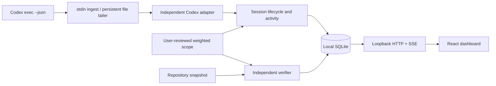

# Architecture and trust model

## Invariants

1. An adapter can return lifecycle and activity only. It cannot set requirement status.
2. A scope is immutable after creation: original prompt, prompt excerpts, check definitions, positive integer weights, and hashes of trusted check files are fixed. There is no scope-edit endpoint.
3. Every verified criterion has observer-produced evidence. Manual review never earns automatic credit. A file assertion's limited meaning is visible in the dashboard.
4. Command execution is separately authorized when locking scope. An executable and argument vector are spawned without a shell. Command output is discarded and never interpreted as proof.
5. Check code is pinned by SHA-256. A changed trusted file blocks the check; a new reviewed scope is required to trust a changed test.
6. The repository is hashed before and after verification. Changed snapshots yield stale results. A two-second observer scan invalidates previous credits when later edits are seen; verification can be rerun automatically if opted in.
7. Lifecycle state and acceptance state are separate. All checks can pass while an agent is interrupted; an idle or “finished” agent can have zero verified weight.
8. Sessions and delivery deduplication commit in one SQLite transaction. File cursor advancement follows durable event delivery, so a crash before cursor persistence can safely replay the batch.

## Persistence and recovery

SQLite uses WAL and FULL synchronous durability. `sessions` stores a JSON session aggregate including scope, current evidence, activity ring (100 records), source cursor, and fingerprint. `deliveries` keeps `(session_id, delivery_id)` unique. Stdin delivery IDs use a fresh stream UUID plus sequence; file IDs use generation plus byte offset. Restart recovery clears checking flags, marks running sessions interrupted, and compares snapshots before serving saved progress.

The stdin CLI applies backpressure by awaiting durable acknowledgement for each line. A lease makes abrupt ingestion-process loss visible within about twenty seconds, subject to poll scheduling. File observation accepts complete UTF-8 newline-delimited records, caps a record at 1 MB, retains partial records in the source file, and detects truncation/prefix changes. The source is expected to be append-only. EOF is not proof that its writer died.

Concurrent verification is rejected per session. After asynchronous filesystem/process work, the engine reloads current session state before merging evidence, preserving newly received agent events. Different sessions can be verified independently, though this MVP is designed for a small personal workspace.

## Repository snapshot boundary

The scanner includes untracked files and fails closed on symlinks and repositories exceeding 20,000 files or 100 MB of observed content. It excludes `.git`, `node_modules`, `dist`, `build`, `coverage`, `.agent-progress`, `.next`, `.cache`, `test-results`, and `playwright-report` by directory name. Explicit file-check paths and trusted verifier paths are additionally fingerprinted, even if inside an excluded directory.

These limits keep a simple polling design tractable. Filesystem checks are not an atomic snapshot and do not defeat a malicious same-user actor racing file replacements. Changes to dependencies, environment, tools, external services, ignored generated content not named as evidence, or transient edits restored between scans are outside the fingerprint model. Rerun verification after those changes. A future isolated worktree/sandbox verifier can strengthen this boundary.

## Test trust and limits

The command's exit code proves the reviewed check passed, not the correctness of every line of application code. Pin all relevant test scripts and fixtures in `trustedFiles`; transitive dependencies are not automatically discovered or pinned. Checks should be deterministic, offline, bounded, and exercise actual behavior. Builds can use an authorized native executable (for example Node running a reviewed build script); a build isn't equivalent to a behavior test.

The baseline filesystem is not itself evidence. A claimed test result, an agent plan checkbox, token count, duration, model confidence, or event frequency never contributes to completion. Existing correct code can satisfy criteria immediately: the metric measures achieved acceptance, not who authored it or effort expended.

Automatic verification runs on changed snapshots, not continuously after failures on an unchanged tree. Retrying a transient failure requires manual verification or another edit. There is no automatic semantic coverage proof or time-to-completion model.

## Privacy and extension boundary

The observer has no remote client integration. Adapter normalization discards arbitrary agent text before persistence. Scope input is checked for common secret patterns; recognized secrets are rejected rather than silently altering a test. The server binds only to loopback, validates host/origin, and requires a local write token. Read endpoints use same-origin browser protections; trusted local processes can read them. This is not a multi-user authorization system.

Add a future adapter by implementing `AgentAdapter` and independent transport fixtures. Keep provider schema validation and session association there. Preserve the engine's rule that only independent verification can grant credit. Claude hooks should map prompt/session identities explicitly; do not overload Codex's event schema.

## Deliberate MVP exclusions

- No silent discovery of interactive Codex/desktop sessions or private transcript schemas.
- No agent launching, permission approvals, process orchestration, model calls, paid APIs, or cloud sync.
- No unreviewed test generation or automatic semantic proof of prompt coverage.
- No manual “100%” button, completion inference, fabricated ETA, or scope mutation.
- No Claude Code implementation yet; only the independent adapter seam and researched contract.
- No sandbox/hostile-process isolation, encrypted storage, distributed database, or multi-user server.

Next architectural steps: stronger snapshots and dependency attestations, explicit scope revisions linked as new sessions, a supported Claude hook adapter, and optional approved local-model drafting. None should weaken the evidence invariants.
